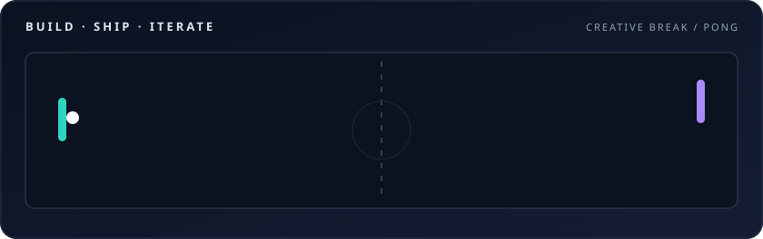

  <h1>David Poza Salgado</h1>
  
<strong>Desarrollador full stack · Producto digital · IA aplicada</strong>

  
Diseño, desarrollo y llevo productos digitales desde la idea hasta producción, con atención a la experiencia, la calidad y la operación.

  
<code>Español</code> · <code>English</code>

  

---

### 🧭 En qué me enfoco

| Área | Enfoque |
| --- | --- |
| **Producto** | Aplicaciones web y de escritorio que resuelven necesidades concretas. |
| **Arquitectura** | Soluciones mantenibles, seguras y preparadas para crecer. |
| **Calidad** | Rendimiento, SEO, accesibilidad y pruebas automatizadas. |
| **Operación** | Automatización, observabilidad y despliegues reproducibles. |
| **IA aplicada** | Integración de modelos con datos y validación de resultados. |

### 🚀 Panel de proyectos

Una selección de productos, experiencias y herramientas que he desarrollado. Abre cada tarjeta para conocer el proyecto.

<table>
<tr>
<td width="50%" valign="top">
<h3>📊 ReportIA</h3>

Aplicación para pymes que transforma datos del negocio en métricas e informes con IA local. En beta.

<a href="https://reportia.net/producto"><strong>reportia.net/producto ↗</strong></a>

</td>
<td width="50%" valign="top">
<h3>🎬 The Choice Protocol</h3>

Experiencia narrativa que recomienda anime y películas mediante decisiones y escenas cinematográficas.

<a href="https://the-choice-protocol.srpouza.workers.dev/"><strong>Abrir demo interactiva ↗</strong></a>

</td>
</tr>
<tr>
<td width="50%" valign="top">
<h3>🎡 Ruleta y Sorteos</h3>

Ruletas y sorteos online con selección aleatoria y resultados verificables, directamente en el navegador.

<a href="https://ruletasorteos-es.pages.dev/"><strong>Abrir Ruleta y Sorteos ↗</strong></a>

</td>
<td width="50%" valign="top">
<h3>🛡️ Defiende la Base</h3>

Tower defense 2D con oleadas de enemigos, torres y mejoras. Versión jugable en el navegador.

<a href="https://defiende-la-base.pages.dev/"><strong>Jugar en el navegador ↗</strong></a>

</td>
</tr>
<tr>
<td width="50%" valign="top">
<h3>💿 Iberia Custom DVDs</h3>

Web de presentación y acceso a un lanzador de discos para Windows.

<a href="https://iberiacustomdvds.es/"><strong>iberiacustomdvds.es ↗</strong></a>

</td>
<td width="50%" valign="top">
<h3>🌸 AnimeGratis</h3>

Plataforma de anime con catálogo, fichas y navegación por contenidos.

<a href="https://animegratis.net/"><strong>animegratis.net ↗</strong></a>

</td>
</tr>
<tr>
<td width="50%" valign="top">
<h3>📚 Gothic New Balance Wiki</h3>

Wiki en español de Gothic II: New Balance, con información sobre gremios, misiones y configuración.

<a href="https://github.com/Davidvx98/gothic-nb-wiki"><strong>Ver proyecto público ↗</strong></a>

</td>
<td width="50%" valign="top">
<h3>🧩 LuckyCodex · Demo SaaS</h3>

Demostración de una plataforma de suscripciones con interfaz web y servicios de backend.

<a href="https://github.com/Davidvx98/demo-luckycodex"><strong>Ver proyecto público ↗</strong></a>

</td>
</tr>
</table>

### 🧰 Tecnologías

#### Frontend

  
  
  
  
  
  

#### Backend y lenguajes

  
  
  
  
  
  
  
  

#### Datos

  
  
  
  

#### Escritorio y multiplataforma

  
  

#### Infraestructura y DevOps

  
  
  
  
  
  

#### Calidad y accesibilidad

  
  
  
  

---

  
<strong>De la idea al producto</strong>

  
<code>Diseñar</code> → <code>Construir</code> → <code>Validar</code> → <code>Publicar</code> → <code>Mejorar</code>

  
Abierto a proyectos y colaboraciones.

