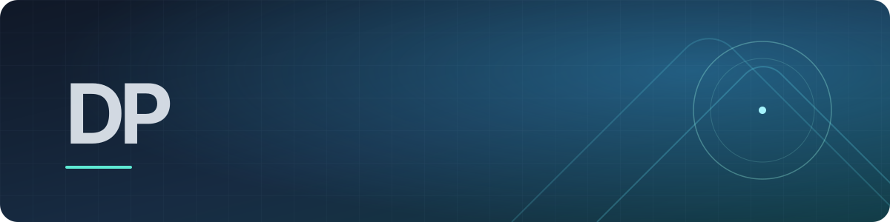

  
  <h1>David Poza Salgado</h1>
  
<strong>Desarrollador full stack · Producto digital · IA aplicada</strong>

  
Diseño, desarrollo y llevo productos digitales desde la idea hasta producción, con atención a la experiencia, la calidad y la operación.

  
<code>Español</code> · <code>English</code>

---

### 🧭 En qué me enfoco

| Área | Enfoque |
| --- | --- |
| **Producto** | Aplicaciones web y de escritorio que resuelven necesidades concretas. |
| **Arquitectura** | Soluciones mantenibles, seguras y preparadas para crecer. |
| **Calidad** | Rendimiento, SEO, accesibilidad y pruebas automatizadas. |
| **Operación** | Automatización, observabilidad y despliegues reproducibles. |
| **IA aplicada** | Integración de modelos con datos y validación de resultados. |

### 🚀 Proyecto destacado

#### [ReportIA](https://reportia.net/producto)

Aplicación de escritorio para pymes y profesionales. Convierte hojas de cálculo, facturas y tickets en informes claros con ayuda de IA local.

- **Importación:** Excel, CSV y documentos del negocio.
- **Análisis:** métricas y comparativas calculadas de forma determinista.
- **Informes:** borradores con evidencias y exportación a PDF, XLSX, CSV y DOCX.
- **Estado:** en beta.

### 🧰 Tecnologías

- **Frontend:** <code>TypeScript</code> <code>Astro</code> <code>React</code> <code>Tailwind CSS</code> <code>GSAP</code>
- **Backend:** <code>Node.js</code> <code>Express</code> <code>Python</code> <code>Rust</code>
- **Datos:** <code>SQLite</code> <code>PostgreSQL</code> <code>DuckDB</code> <code>Redis</code>
- **Lenguajes:** <code>JavaScript</code> <code>Java</code> <code>Dart</code> <code>SQL</code> <code>Bash</code>
- **Plataforma y DevOps:** <code>Tauri</code> <code>Flutter</code> <code>Cloudflare</code> <code>Linux</code> <code>Docker</code> <code>PM2</code> <code>GitHub Actions</code> <code>pnpm</code>
- **Calidad:** <code>Playwright</code> <code>Vitest</code> <code>ESLint</code> <code>axe</code>

---

**Abierto a proyectos y colaboraciones.**
